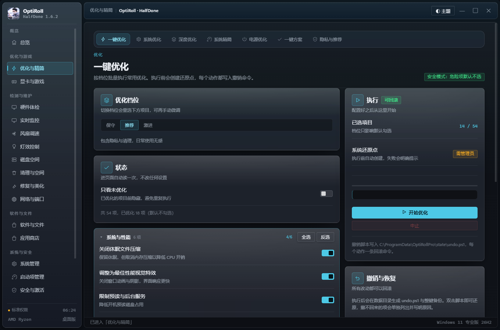
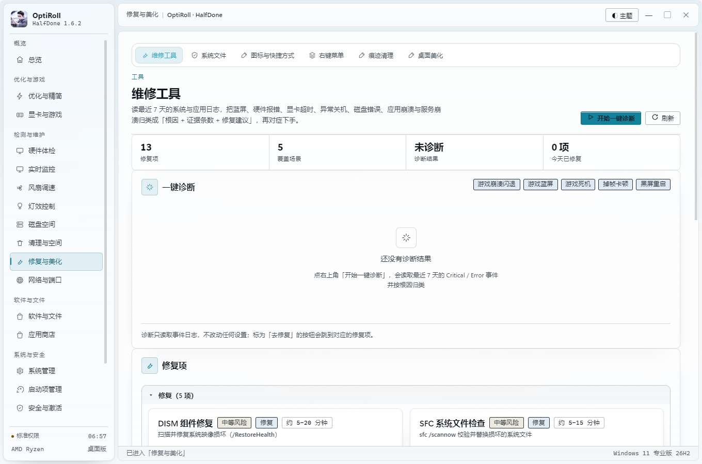
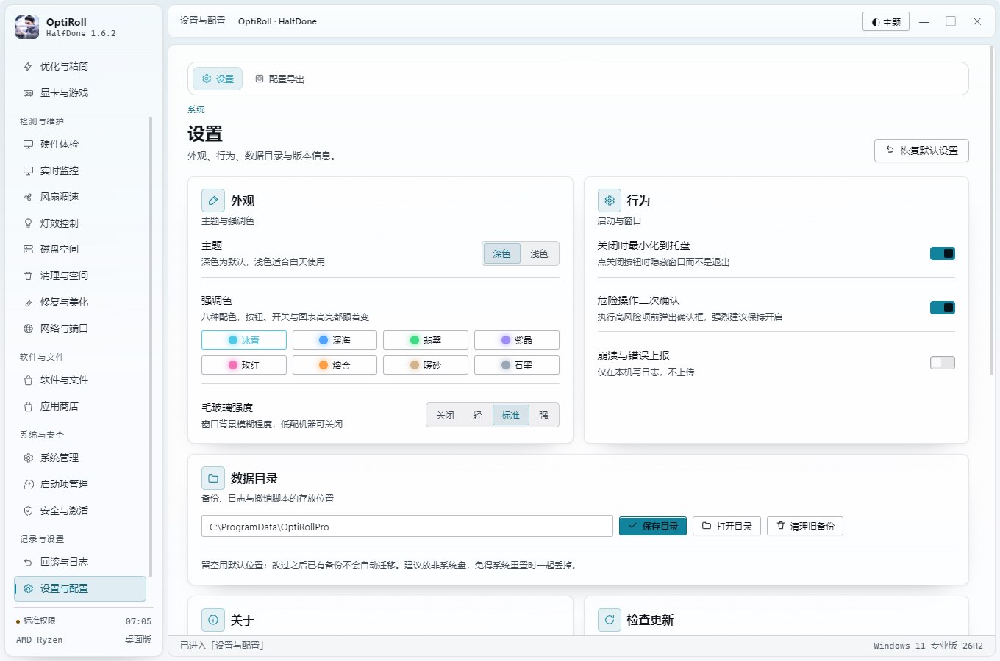

# OptiRoll · HalfDone 1.6.5

Windows 优化工具箱。优化、显卡调优、硬件体检、清理与磁盘、灯效控制，收在一个桌面程序里。
每项改动都留回滚记录，危险的先弹确认，能进回收站的绝不直接删。

**本仓库只放打包好的程序。** 这里只发布正式版，beta 版本不在此处。

---

## 下载

到 [Releases](https://github.com/HalfDone03/optiroll/releases/latest) 下最新版：

| 文件 | 说明 |
| --- | --- |
| `OptiRoll-<版本>-portable.exe` | **便携版**，双击就跑，不写注册表、不进开始菜单，退出自动清临时目录 |
| `OptiRoll-<版本>-setup.exe` | **安装版**，按向导装，可选开机启动 |

当前版本：**1.6.5**

---

## 里面有什么

**24 个入口，74 个功能页**，分 7 组：

| 组 | 入口 | 内容 |
| --- | --- | --- |
| **概览** | 总览 | 整机状态 · 一键入口 · 功能搜索 · 待重启提示 |
| **优化与精简** | 优化与精简 / 延迟优化 / 安全中心 / 虚拟化安全（VBS） | 一键优化（54 项）· 系统优化 · 深度优化 · 系统精简 · 电源 · 隐私 · 一键方案；延迟优化；Defender 删除与装回 · TrustedInstaller 直改 · 兼容性自检；VBS 与内存完整性 |
| **显卡与游戏** | 显卡与游戏 / 显示调色 / 分辨率修改 / 驱动下载 | 显卡伪装 · DLSS 管理 · 游戏优先级 · ACE 反作弊 · 游戏库；驱动层亮度对比度色温；分辨率与刷新率切换；按显卡系列推荐驱动 |
| **硬件与维护** | 实时监控 / 硬件体检 / 清理与空间 / 风扇调速 / 灯效控制 | CPU 内存显卡磁盘温度每秒刷新；体检 · 系统信息 · 跑分 · 蓝屏 · 驱动管理 · 虚拟内存 · 磁盘空间；垃圾清理 · 应用缓存 · 磁盘分析 · 注册表；风扇档位与曲线；灯效小白模式与精细调整 |
| **软件与文件** | 软件与文件 / 软件商店 | 软件卸载（Geek 式）· 进程管理 · 文件复制；常用软件与运行库 |
| **系统与维护** | 系统管理 / 网络工具 / 修复与美化 / 诊断中心 / Windows 授权与激活 | 服务 · 计划任务 · Windows 功能 · 更新 · 启动项；网络诊断 · DNS · 测速 · hosts · 端口；SFC/DISM · 图标快捷方式 · 右键菜单 · 痕迹清理 · 桌面美化；11 项系统自检 + 脱敏诊断报告；Windows/Office 授权状态与激活 |
| **记录与设置** | 回滚与日志 / 设置与配置 / 捐赠支持 | 执行记录（含原始日志展开）· 撤销与恢复 · 系统还原；主题配色 · 毛玻璃档位 · 数据目录 · 配置导出 |

深色 / 浅色 / 跟随系统，8 种强调色，毛玻璃四档，改完立刻生效。

---

## 权限

| 功能 | 权限 |
| --- | --- |
| 看进程 / 服务 / 任务 / 硬件信息 | 普通用户 |
| 改服务、启停计划任务、SFC / DISM、注册表删除 | 管理员（会弹一次 UAC） |
| 灯效写总线、风扇调速、组件存储清理、Defender 操作 | 管理员 |

没权限时不会静默失败，会明确告诉你要管理员。

---

## 安全

- 每个写操作都进回滚记录，在「撤销与恢复」里能一键还原
- 垃圾清理、社交缓存、AI 模型删除默认进回收站
- 删注册表前逐条 `reg export` 备份
- 受保护路径一律跳过，另可自建白名单
- 灯效渲染有 5 秒心跳看门狗，出问题自动回滚
- 安全中心的 Defender 相关操作全部先备份再动手，支持完整装回

**动之前建议先在总览页建一个系统还原点。**

---

## 更新

程序里「设置 → 检查更新」会读本仓库的 Releases，比对版本号后提示。

各版本重要改动见 [Releases](https://github.com/HalfDone03/optiroll/releases)。

---

## 说明

本工具直接改系统设置，误用有风险。用于自己的机器，后果自负。
