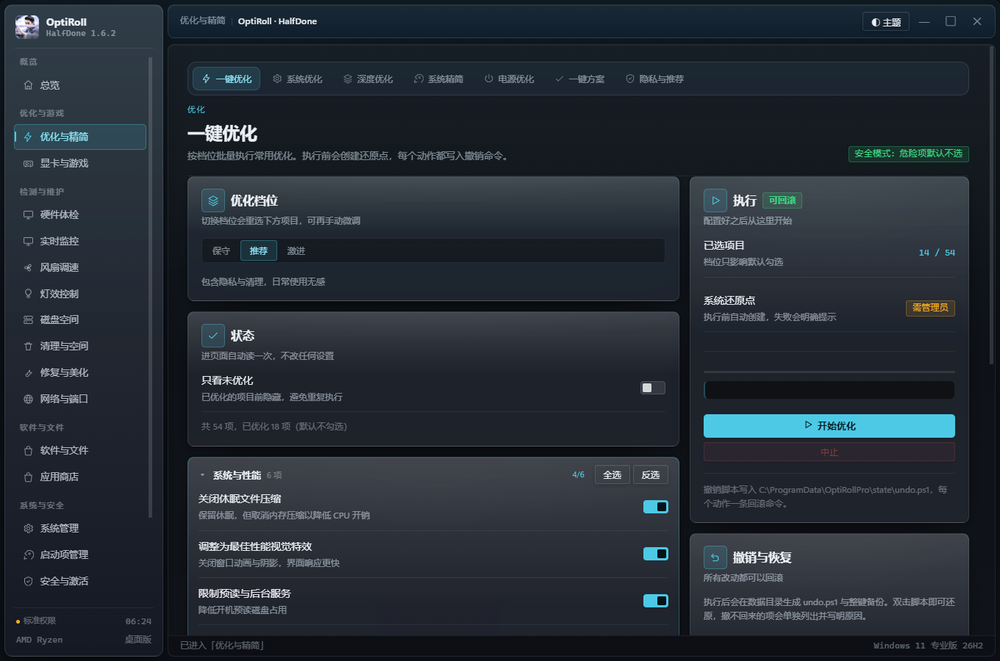
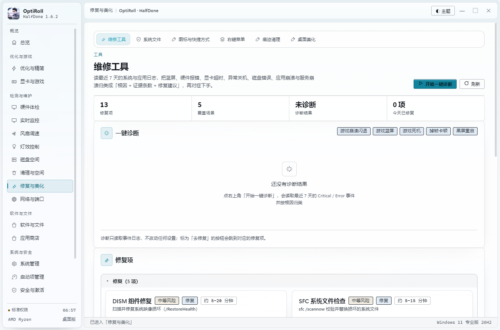

# OptiRoll · HalfDone 1.6.2

Windows 优化工具箱。优化、显卡调优、硬件体检、清理与磁盘、灯效控制，收在一个桌面程序里。
每项改动都留回滚记录，危险的先弹确认，能进回收站的绝不直接删。

**本仓库只放打包好的程序，不放源码。** 源码在 [optiroll-source](https://github.com/HalfDone03/optiroll-source)。

---

## 下载

到 [Releases](https://github.com/HalfDone03/optiroll/releases/latest) 下最新版：

| 文件 | 说明 |
| --- | --- |
| `OptiRoll-<版本>-portable.exe` | **便携版**，双击就跑，不写注册表、不进开始菜单，退出自动清临时目录 |
| `OptiRoll-<版本>-setup.exe` | **安装版**，按向导装，可选开机启动 |

当前版本：**1.6.2**

---

## 里面有什么

19 个入口，55 个功能页：

| 入口 | 内容 |
| --- | --- |
| 优化与精简 | 一键优化（54 项，31 项能自动识别已优化）、系统优化、深度优化、精简、电源、隐私、预设 |
| 显卡与游戏 | 显卡设置、DLSS 模型、游戏优先级、ACE、游戏库 |
| 硬件体检 | 体检、系统信息、跑分压测、蓝屏与稳定性、驱动管理、更新检查、虚拟内存 |
| 实时监控 | CPU / 内存 / 显卡 / 磁盘占用、温度、占用最高进程 |
| 风扇调速 | 档位、曲线、一键预设 |
| 灯效控制 | 小白模式与精细调整、板载灯控、内存灯、外设灯、整机单色同步 |
| 磁盘空间 | 分区概览、文件夹占用、大文件、重复文件、瘦身向导 |
| 清理与空间 | 垃圾清理（20 分类）、应用缓存、磁盘分析、注册表冗余 |
| 修复与美化 | 维修工具、系统文件（SFC/DISM）、图标与快捷方式、右键菜单、痕迹清理、桌面美化 |
| 网络与端口 | 网络诊断、端口与连接 |
| 软件与文件 | 软件卸载（Geek 式）、进程管理、文件复制 |
| 应用商店 | 常用软件一键装与更新 |
| 系统管理 | 服务、计划任务、Windows 功能、Windows 更新 |
| 启动项管理 | Run 键、启动文件夹、任务计划、服务四类统一管理 |
| 安全与激活 | 安全与授权、系统激活 |
| 回滚与日志 | 撤销与恢复、系统还原、运行日志 |
| 设置与配置 | 主题配色、毛玻璃档位、数据目录、配置导出 |

---

## 权限

| 功能 | 权限 |
| --- | --- |
| 看进程 / 服务 / 任务 / 硬件信息 | 普通用户 |
| 改服务、启停计划任务、SFC / DISM、注册表删除 | 管理员（会弹一次 UAC） |
| 灯效写总线、风扇调速、组件存储清理 | 管理员 |

没权限时不会静默失败，会明确告诉你要管理员。

---

## 安全

- 每个写操作都进回滚记录，在「撤销与恢复」里能一键还原
- 垃圾清理、社交缓存、AI 模型删除默认进回收站
- 删注册表前逐条 `reg export` 备份
- 受保护路径一律跳过，另可自建白名单
- 灯效渲染有 5 秒心跳看门狗，出问题自动回滚

**动之前建议先在总览页建一个系统还原点。**

---

## 更新

程序里「设置 → 检查更新」会读本仓库的 Releases，比对版本号后提示。

各版本重要改动见 [Releases](https://github.com/HalfDone03/optiroll/releases) 与 [CHANGELOG.md](CHANGELOG.md)。

---

## 说明

本工具直接改系统设置，误用有风险。用于自己的机器，后果自负。

源码、构建方式、自检脚本：见 [optiroll-source](https://github.com/HalfDone03/optiroll-source)。
